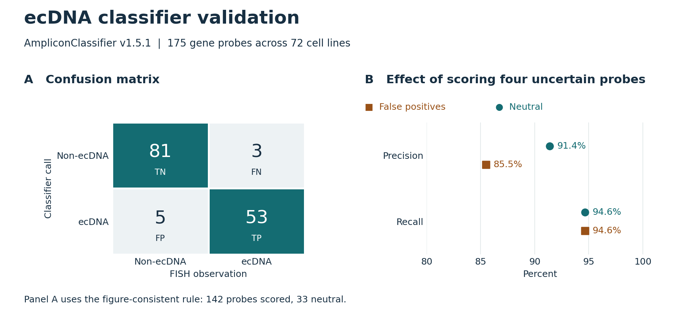

# AmpliconSuite 2026 reproduction

[](https://github.com/arjunbioinfo/ampliconsuite-2026-reproducibility/actions/workflows/ci.yml)
[](LICENSE)

Independent computational reproduction of the AmpliconClassifier v1.5.1 ecDNA validation in [Luebeck et al., Nature Methods (2026)](https://doi.org/10.1038/s41592-026-03264-x). The first milestone reconstructs Figures 1d and 1e from deposited FISH observations and classifier calls. Each observation represents a gene probed in one cell line.

## Figure 1 result



Across 175 gene probes in 72 cell lines, the treatment of four probes changes estimated precision by 5.9 percentage points.

| Treatment of four uncertain probes | TP | FP | TN | FN | Neutral | Precision | Recall |
| --- | ---: | ---: | ---: | ---: | ---: | ---: | ---: |
| Count as false positives under the written Methods | 53 | 9 | 81 | 3 | 29 | 85.5% | 94.6% |
| Treat as neutral to match Figure 1d | 53 | 5 | 81 | 3 | 33 | 91.4% | 94.6% |

All four probes had an ecDNA classifier call and an HSR of unknown chromosomal origin on FISH. Treating them as neutral reproduces the published matrix. That scoring choice is inferred from the deposited records and the figure.

| Cell line | Probed gene |
| --- | --- |
| BT474 | ERBB2 |
| SF268 | KMT2A |
| SF268 | MMP8 |
| SJSA1 | MDM2 |

## Run from the repository root

Tested with Python 3.12.14 and openpyxl 3.1.5. The first run uses curl to download two small workbooks from the versioned NIH PMC archive. Subsequent runs verify the cached inputs against data/SHA256SUMS and work offline.

```sh
python3 -m venv .venv
.venv/bin/python -m pip install -r requirements.txt
.venv/bin/python scripts/reproduce_validation.py
```

[Validation results and interpretation](results/validation/REPORT.md) · [Probe-level audit](results/validation/probe_audit.tsv) · [Computed metrics](results/validation/metrics.tsv)

To regenerate the figure from the metrics table, install `matplotlib==3.10.1` in the same environment and run `.venv/bin/python scripts/plot_validation.py`.

## Planned analyses

1. Reconstruct Figure 2b from deposited ICGC, HMF and GLASS amplicon outputs, counting CDK4–MDM2 co-amplification per sample and distinguishing shared ecDNA, distinct ecDNAs and chromosomal amplification. Use the published 61 samples as a comparison after counting.
2. Run the upstream test dataset with recorded pipeline, reference assembly and classifier versions, then compare classifications with deposited outputs.
3. Extend the benchmark with a coverage sensitivity experiment, recording the input read set, subsampling seeds and changes in calls.

Raw-read processing, independent image scoring and the earlier classifier versions are outside the completed first milestone.

## Data and credit

The FISH observations, classifier calls and Figure 1 source data come from Luebeck *et al.*, [*Nature Methods* 23, 2141–2146 (2026)](https://doi.org/10.1038/s41592-026-03264-x). The two workbooks in `data/` are unmodified copies of the article's supplementary files, redistributed under its [CC BY 4.0](https://creativecommons.org/licenses/by/4.0/) licence; see [data/README.md](data/README.md). All credit for the AmpliconSuite tools, the cell-line imaging and the original analysis belongs to the authors. This repository is an independent reproduction and is not affiliated with or endorsed by them.

## License

The code in this repository (`scripts/`) is released under the [MIT License](LICENSE). The files in `data/` keep their original CC BY 4.0 licence.

## Author

**Mallikarjuna Thippana, PhD** — Computational Biologist, Karolinska Institutet  
[Portfolio](https://arjunbioinfo.github.io/) · [ORCID](https://orcid.org/0000-0001-8485-8626) · [Google Scholar](https://scholar.google.com/citations?user=NpLUj68AAAAJ) · [GitHub](https://github.com/arjunbioinfo)
